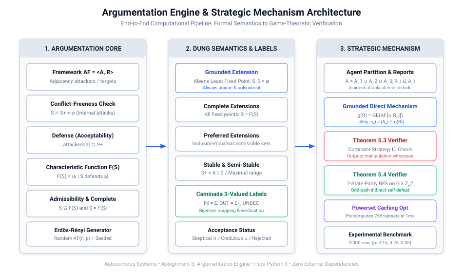
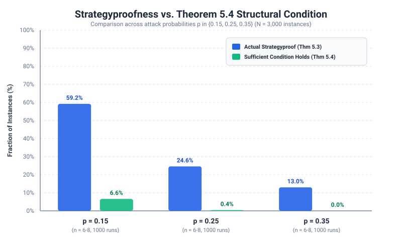
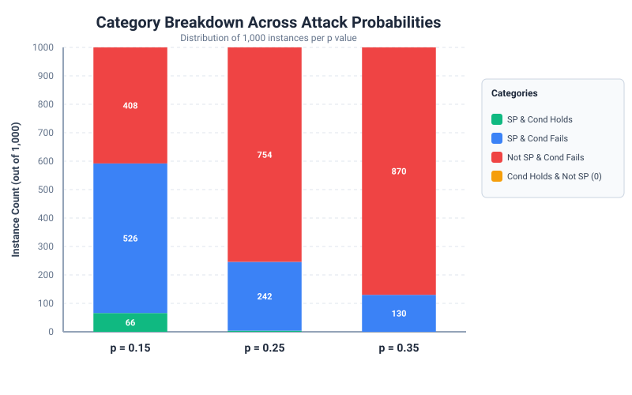
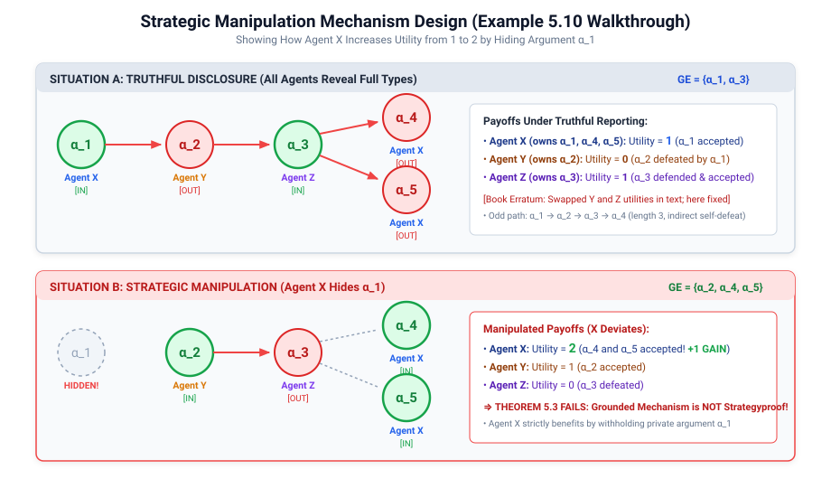
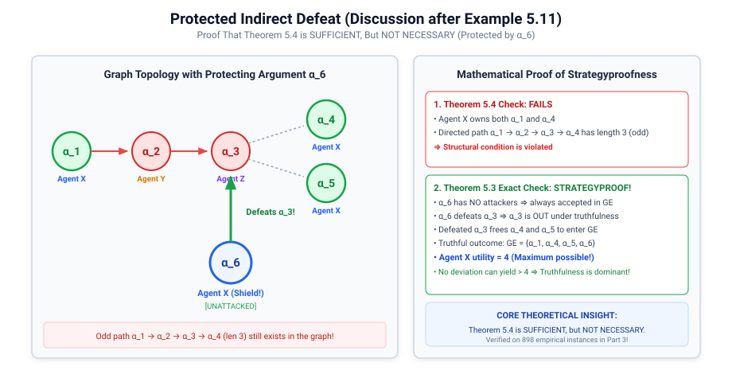
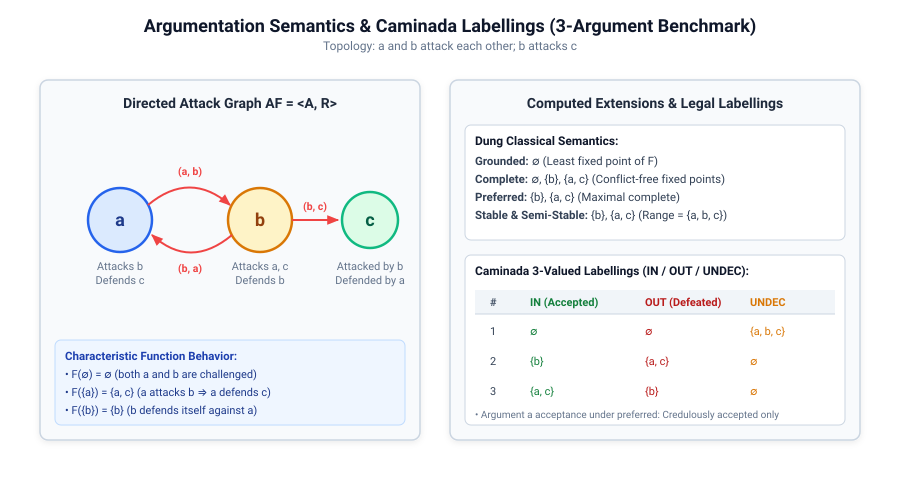
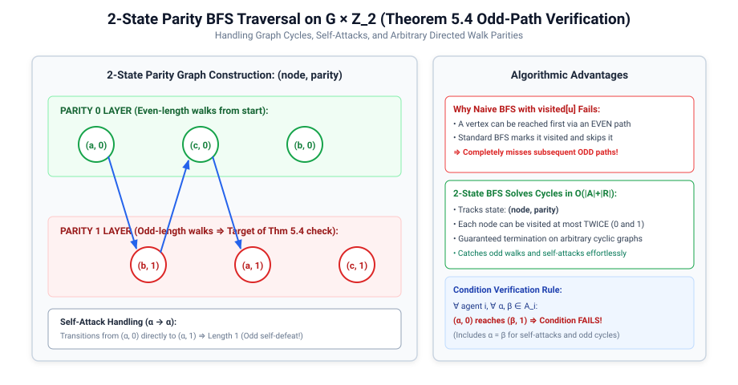

# Abstract Argumentation Engine & Strategic Mechanism

**Course:** Autonomous Systems  
**Project:** Assignment 3 — Argumentation Engine  
**Authors:**
- **Bhargav Shekokar** (B23CS1008)
- **Darsh patel** (B23CM1054)
- **Tanisha Saini** (B23CM1042)
- **Priyanshu Shah** (B23CS1099)

---

## Executive Summary & Overview

This repository provides a mathematically rigorous, fully verified computational engine and strategic mechanism design framework for **Abstract Argumentation**. The project bridges three computer science disciplines:

1. **Artificial Intelligence (Knowledge Representation & Reasoning):** Determining collective justification of conflicting arguments via classical Dung semantics (Grounded, Complete, Preferred, Stable, Semi-stable) and Caminada 3-valued $(IN, OUT, UNDEC)$ labellings.
2. **Graph Theory:** Representing directed attack relations, cyclic structures, and parity-aware directed walk/path reachability ($G \times \mathbb{Z}_2$).
3. **Game Theory & Mechanism Design:** Analyzing multi-agent strategic argumentation where self-interested agents possess private argument subsets and can strategically withhold arguments to manipulate the Grounded Direct Mechanism.

We empirically and theoretically evaluate **Theorem 5.3** (exact dominant-strategy incentive compatibility) and **Theorem 5.4** (the structural odd-path sufficient condition) across **3,000 randomized argumentation frameworks**.



---

## Key Experimental Results (3,000 Instances)

From our 3,000 randomized benchmark instances across 3 agents, $n \in \{6, 7, 8\}$ arguments, and attack probabilities $p \in \{0.15, 0.25, 0.35\}$:

| Attack Prob ($p$) | Instances | Actually Strategyproof (Thm 5.3) | Strategyproof Fraction ($f_p$) | Thm 5.4 Condition Holds | Thm 5.4 Fraction | Cond Holds & NOT SP (Exp. 0) | SP & Cond Fails (Sufficiency $\ne$ Necessity) |
| :---: | :---: | :---: | :---: | :---: | :---: | :---: | :---: |
| **0.15** | 1,000 | 592 | **59.20%** | 66 | 6.60% | **0** | 526 |
| **0.25** | 1,000 | 246 | **24.60%** | 4 | 0.40% | **0** | 242 |
| **0.35** | 1,000 | 130 | **13.00%** | 0 | 0.00% | **0** | 130 |
| **Overall** | **3,000** | **968** | **32.27%** | **70** | **2.33%** | **0 (100% Sound)** | **898 (29.93%)** |

### Key Findings & Insights:
1. **Theorem 5.4 Soundness:** Exactly **0 false positives** across all 3,000 instances. Whenever no agent holds arguments connected by an odd-length attack path, strategyproofness is guaranteed.
2. **Sufficiency Without Necessity:** Exactly **898 instances** (29.93%) were strategyproof even though Theorem 5.4's condition failed.
3. **Graph Density Impact:** Strategyproofness drops precipitously from **59.20%** down to **13.00%** as $p$ increases from 0.15 to 0.35 due to the combinatorial proliferation of attack cycles.

<p align="center">
  
  
</p>

---

## Literature Pedigree & Textbook Errata Resolution

The foundational theory and numbered theorems trace directly to **Yoav Shoham & Kevin Leyton-Brown (2009)**, *Multiagent Systems: Algorithmic, Game-Theoretic, and Logical Foundations*, Cambridge University Press, specifically **Chapter 5: Argumentation among Agents**, and original research by **Iyad Rahwan & Kate Larson (AAMAS 2008, IJCAI 2009)**.

Our implementation resolves two documented misprints present in the textbook literature (noted on Page 2 of the Assignment PDF):

### 1. Example 5.10: Swapped Utility Erratum
- **Topology:** $\alpha_1 \to \alpha_2 \to \alpha_3 \to \alpha_4$, $\alpha_3 \to \alpha_5$.
- **Ownership:** Agent $X$: $\{\alpha_1, \alpha_4, \alpha_5\}$, Agent $Y$: $\{\alpha_2\}$, Agent $Z$: $\{\alpha_3\}$.
- **Textbook Misprint:** In the printed prose, the utilities of agents $y$ and $z$ were swapped.
- **Mathematical Reality:** Under truthful reporting, $\alpha_1$ is unattacked $\implies \alpha_1 \in GE$; $\alpha_1$ defeats $\alpha_2 \implies \alpha_2$ is OUT; $\alpha_3$ is defended $\implies \alpha_3 \in GE$; $\alpha_3$ defeats $\alpha_4, \alpha_5$.
- **Correct Truthful Payoffs:** $u_X = 1$, $u_Y = 0$, $u_Z = 1$.
- **Strategic Manipulation:** If Agent $X$ conceals $\alpha_1$, $\alpha_2$ becomes unattacked, defeating $\alpha_3$, which frees $\alpha_4$ and $\alpha_5$ to enter $GE$. Agent $X$'s utility strictly increases from **1 to 2**, proving the grounded mechanism is manipulable.



### 2. Discussion after Example 5.11: Protecting Argument Erratum
- **Textbook Misprint:** The author referred to the protective argument as $\alpha_5$, which already existed as an argument owned by $X$ attacked by $\alpha_3$.
- **Mathematical Reality:** The protective argument is a new, unattacked argument **$\alpha_6$** owned by Agent $X$ with directed attack $\alpha_6 \to \alpha_3$.
- **Proof of Non-Necessity:** Because $\alpha_6$ is unattacked, it is unconditionally accepted, defeating $\alpha_3$ and protecting both $\alpha_4$ and $\alpha_5$. Agent $X$ achieves utility $u_X = 4$ (maximum possible). Truthfulness is a dominant strategy, yet the odd path $\alpha_1 \to \alpha_2 \to \alpha_3 \to \alpha_4$ (len 3) still exists in the graph. This proves Theorem 5.4 is **sufficient, but NOT necessary**.



---

## Project Structure & Architecture

```
Argumentation/
├── src/
│   └── argumentation/
│       ├── __init__.py           # Package exports
│       ├── framework.py          # ArgumentationFramework graph & adjacency representation
│       ├── defense.py            # Conflict-free, defense, characteristic function F, complete
│       ├── semantics.py          # Grounded, Complete, Preferred, Stable, Semi-stable semantics
│       ├── labelling.py          # Caminada 3-valued labellings (IN/OUT/UNDEC) & verification
│       ├── acceptance.py         # Skeptical, credulous, and rejected acceptance status
│       ├── mechanism.py          # Grounded Direct Mechanism & best response evaluation
│       ├── strategyproof.py      # Theorem 5.3 exact IC check & Theorem 5.4 2-state parity BFS
│       ├── graph_generator.py    # Erdős-Rényi AF generator & uniform agent partitioning
│       └── visualizer.py         # Terminal ASCII tables & formatting
├── experiments/
│   ├── run_experiments.py       # 3,000-instance benchmark generator & statistical suite
│   └── plot_results.py          # Vector SVG chart and interactive dashboard generator
├── tests/
│   ├── test_framework.py        # Framework, defense & characteristic function tests
│   ├── test_semantics.py        # Classical semantics & hierarchy inclusion tests
│   ├── test_labelling_acceptance.py # Caminada labelling & acceptance tests
│   └── test_strategic.py        # Strategic manipulation, Thm 5.3 & 5.4 tests
├── examples/
│   └── textbook_examples.py     # Canonical textbook cases (5.10, 5.11, odd cycles)
├── diagrams/                    # Standalone publication-grade SVGs
│   ├── system_architecture.svg
│   ├── semantics_labelling_example.svg
│   ├── example_5_10_manipulation.svg
│   ├── example_5_11_protected_defeat.svg
│   └── parity_bfs_state_graph.svg
├── results/                     # Experimental outputs & datasets
│   ├── instances.csv            # Granular raw data for all 3,000 runs
│   ├── summary.csv              # Aggregated statistics by probability p
│   ├── counterexamples.json     # Manipulation witnesses & deviation traces
│   ├── strategyproof_comparison.svg
│   ├── outcomes_breakdown.svg
│   └── dashboard.html           # Interactive visual dashboard
├── demo.py                      # 6-step interactive CLI demonstration
├── generate_diagrams.py         # Vector diagram generator script
├── validate_docs.py             # XML/HTML strict validator script
├── report.html                  # Formal comprehensive HTML report
├── REPORT.md                    # Full markdown technical report
├── requirements.txt             # Project requirements (Zero external dependencies!)
└── README.md                    # Project documentation (this file)
```

---

## Core Algorithms & Implementations

### Part 1: Argumentation Engine
- **Framework Representation:** Directed graph $AF = \langle A, R \rangle$ with dual precomputed adjacency dictionaries (`attackers` and `targets`) enabling $O(1)$ neighborhood queries.
- **Conflict-Freeness:** $S \cap S^+ = \emptyset$.
- **Defense (Acceptability):** $\forall b \in \text{attackers}[a], \exists c \in S \text{ s.t. } (c, b) \in R$.
- **Characteristic Function:** $F_{AF}(S) = \{a \in A \mid S \text{ defends } a\}$.
- **Classical Semantics:**
  - *Grounded:* Unique least fixed point of $F_{AF}$ via Kleene iteration from $\emptyset$.
  - *Complete:* All conflict-free fixed points $S = F_{AF}(S)$.
  - *Preferred:* Inclusion-maximal complete extensions.
  - *Stable:* Conflict-free sets with range $S \cup S^+ = A$. Correctly returns `[]` when non-existent (e.g. odd cycles).
  - *Semi-Stable:* Complete extensions with inclusion-maximal range $S \cup S^+$.
- **Caminada 3-Valued Labellings:** Bijective $(IN, OUT, UNDEC)$ mappings with independent condition validation.



### Part 2: Strategic Argumentation Mechanism
- **Grounded Direct Mechanism:** Evaluates $g(R_1, \dots, R_N) = GE(AF[\bigcup_{i=1}^N R_i])$. Correctly deletes incident attack edges when arguments are withheld.
- **Utility:** $u_i = |A_i \cap g(R)|$ against true owned arguments.
- **Theorem 5.3 Verifier:** Exhaustively checks whether truthfulness $A_i$ is a weak dominant strategy against all $R_{-i} \in \prod_{j \neq i} 2^{A_j}$ and deviations $S_i \subseteq A_i$.
- **Theorem 5.4 2-State Parity BFS:** Explores $(vertex, parity) \in A \times \{0, 1\}$ over $G \times \mathbb{Z}_2$, catching odd paths, cycles, and self-attacks in exact $O(|A| + |R|)$ time.



### Part 3: Powerset Grounded Caching Optimization
To verify Theorem 5.3 across 3,000 instances without multi-core overhead:
- Any revealed profile is a subset of $A$ ($n \le 8$).
- Total possible revealed subsets: $2^8 = 256$.
- We precompute $GE(AF[X])$ for all 256 subsets in ~1 ms upon framework creation.
- Theorem 5.3 deviation checks execute via $O(1)$ dictionary lookups, allowing **3,000 instances to be verified in 2.50 seconds** (~1,200 instances/second).

---

## Quickstart & Execution Guide

### Zero Dependencies Setup
The entire engine runs on **pure Python 3 (standard library only)**.
```powershell
# Navigate to the repository
cd C:\Users\ASUS\Downloads\prog\Argumentation
```

### 1. Run Automated & Interactive CLI Demonstration
Executes all 6 required demonstration steps with formatted ASCII tables:
```powershell
python demo.py
```
To run an individual step:
```powershell
python demo.py --step 4
```

### 2. Run Comprehensive Unit Test Suite
Executes all 25 unit and integration tests:
```powershell
python -m unittest discover tests
```
*Output:*
```
.........................
----------------------------------------------------------------------
Ran 25 tests in 0.002s

OK
```

### 3. Re-run 3,000 Randomized Experiments
```powershell
python -m experiments.run_experiments
```

### 4. Re-generate Plots & Interactive Dashboard
```powershell
python -m experiments.plot_results
```

### 5. Validate All SVGs & HTML Documentation
```powershell
python validate_docs.py
```

### 6. View Submission Reports
- **Formal HTML Technical Report:** Open [`report.html`](report.html) in any web browser (printable to PDF via `Ctrl+P`).
- **Interactive Visual Dashboard:** Open [`results/dashboard.html`](results/dashboard.html) in any web browser.
- **Markdown Technical Report:** View [`REPORT.md`](REPORT.md).

---

## Answers to Required Assignment Questions

1. **What is the fraction of instances that are strategyproof for each $p$?**
   - $p = 0.15$: **59.20%**
   - $p = 0.25$: **24.60%**
   - $p = 0.35$: **13.00%**
   - *Reason:* Denser graphs multiply indirect attack paths, dramatically expanding strategic manipulation opportunities.

2. **Are there instances that satisfy the condition of Theorem 5.4 yet are not strategyproof?**
   - **Exactly 0 instances** across all 3,000 runs, empirically confirming the 100% mathematical soundness of Theorem 5.4 as a sufficient condition.

3. **Are there instances that are strategyproof although the condition fails?**
   - **898 instances** (29.93% of the total dataset), empirically confirming that Theorem 5.4 is **conservative and not necessary**. Protective arguments and competing agent attacks frequently shield an agent's positions.

---

## Submission Checklist

- [x] **Source Code:** Typed, modular, clean Python in `src/argumentation/` (zero dependencies).
- [x] **Unit Tests:** 25 passing automated unit tests in `tests/`.
- [x] **Demonstration:** Interactive 6-step CLI script in `demo.py`.
- [x] **Full Datasets:** `results/instances.csv`, `results/summary.csv`, `results/counterexamples.json`.
- [x] **Vector Diagrams:** Standalone high-res SVGs in `diagrams/` and `results/`.
- [x] **Interactive Dashboard:** `results/dashboard.html`.
- [x] **Technical Reports:** Formally documented in `report.html` and `REPORT.md`.
- [x] **Documentation:** Comprehensive `README.md` project document.
